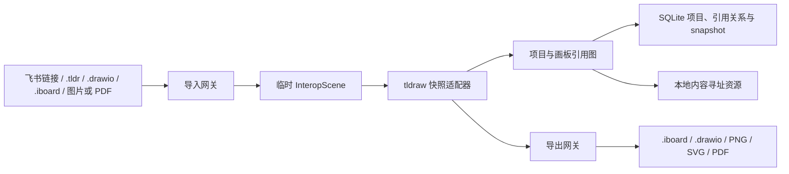

# 飞书式无限画板设计规格

**状态：** 已批准；飞书真实授权验收延期，当前为 `pending-user-authorization`
**日期：** 2026-07-22
**目标用户：** 单人、本地自用
**工作区：** `G:\work\策划\无限画布`

## 1. 项目目标

从空项目构建一个飞书风格的无限画板应用，覆盖常用白板编辑能力，并重点扩展：

1. 画板之间可建立多对多的嵌套引用和普通链接。
2. 用户可通过右键菜单进入被引用画板。
3. 用户可通过返回按钮、访问路径面包屑、浏览器历史和快捷键返回实际来源画板。
4. 使用应用内浏览器式顶部标签栏切换多个 Board；同一 Board 可在显式操作下打开多个独立会话标签，每个窗口只挂载一个活动 editor，并通过写租约避免自身并发编辑冲突。
5. 支持普通元素跨 Board 复制粘贴，并对 Shape、binding、资源和 `board-reference` 采用可验证、可原子撤销的专用规则；跨 Project 的引用只降级为普通视觉卡片。
6. 支持将 `.iboard` 完整合并到当前 Project，并支持 `.tldr` 和 `.drawio` 的单 Board 结构化导入；支持本地文件拖拽创建新 Board，以及 PNG/JPEG/WebP/SVG/PDF 的视觉导入和 PNG/SVG/PDF 导出。
7. 支持通过飞书官方 Board OpenAPI 结构化导入已有飞书画板。
8. 保留未来更换画布内核、扩展服务端存储和增加多人协作的能力，但首期不实现实时协作。

## 2. 已确认约束

- 当前目录为空，不存在可复用代码、依赖或 Git 历史。
- 项目只供个人使用，优先本地运行和本地数据控制。
- 首期不实现多人实时协作、协作者光标、在线分享和复杂权限系统。
- 不复制飞书商标、品牌图标或私有素材，只参考其功能与交互模式。
- 不依赖飞书私有接口、Cookie 自动化、页面缓存、私有 WebSocket 或未公开剪贴板协议。
- 飞书导入必须使用官方 OpenAPI，或者使用用户主动提供的 `.drawio`、PNG、SVG、PDF 文件。
- 飞书授权前允许完成全部核心开发、mock provider、合同测试和常规回归；未授权不视为工程失败。
- 默认测试和 CI 不读取真实飞书凭据、不访问飞书网络。真实 smoke/E2E 必须由 `FEISHU_REAL_SMOKE=1` 显式开启。
- 跨 Board 剪贴板使用 tldraw 的公开序列化能力、浏览器 Clipboard API 和应用内临时状态，不依赖飞书剪贴板格式。
- 每个应用窗口只允许一个活动 tldraw editor；标签在首次可能修改 Board 的输入前必须原子取得 `(projectId, boardId)` 写租约，未持有租约的同 Board 标签只读。
- `.iboard` 导入固定为合并到当前 Project，不替换当前 Project，也不覆盖其 `rootBoardId`。
- 跨 Project 粘贴 `board-reference` 时必须清除结构引用字段并降级为普通视觉卡片，不建立跨项目 edge。
- 任何不支持的导入内容都必须显示兼容性报告，不允许静默丢失。

## 3. 非目标

首期明确不包含：

- 多人实时同步和冲突合并。
- 文档级组织权限、分享链接和审批流程。
- 飞书评论、@通知和协作者跟随。
- 移动端原生应用。
- 与飞书复杂节点的无损双向同步。
- 完整复刻飞书全部模板、素材库和视觉细节。
- 在线 SaaS 部署所需的租户隔离、计费、限流和审计中心。
- 在后台同时保活多个 tldraw editor，或允许两个会话并行编辑同一 Board。
- 将应用标签、访问 history、视口、编辑租约、undo/redo receipt 或脏草稿写入 `.iboard`。
- 跨 Project 粘贴时建立可编辑的跨项目 Board 引用。

## 4. 飞书能力与兼容边界

### 4.1 飞书 UI 能力

已确认飞书画板包含图形、文本、便签、连接线、分区、表格、画笔、思维导图、图片、图标、模板、Mermaid、PlantUML、评论、网格、缩放和协作光标等功能。

飞书 UI 当前：

- 导入：只明确支持 `.drawio`。
- 导出：支持大、中、小 PNG 和矢量 PDF。
- 不提供可下载的公开原生可编辑工程格式。
- 产品所称的“画板文件”本质上是云文档或文档中的 Board Block。

### 4.2 飞书 Board OpenAPI

结构化导入使用官方接口：

- `GET /open-apis/board/v1/whiteboards/{whiteboard_token}/nodes`
- `GET /open-apis/board/v1/whiteboards/{whiteboard_token}/theme`
- `GET /open-apis/board/v1/whiteboards/{whiteboard_token}/download_as_image`

当前公开 Board v1 SDK 未提供“下载完整原生工程包”或整板 SVG 导出接口；整板视觉基准使用 `download_as_image`，节点自身携带的 SVG 数据按公开字段保留。读取节点至少需要 `board:whiteboard:node:read`，调用身份还必须对目标画板具有真实访问权限。

从 Wiki 或 Docx 链接导入时，数据链路为：

```text
Wiki/Docx URL
  -> 解析文档 token 和 block
  -> 获取 block.board.token
  -> 调用 Board API 获取 nodes、theme 和基准图片
  -> 转换为临时 InteropScene
```

公开节点模型包含父子关系、几何、文本、图片、基础图形、连接线、分区、表格、手绘、SVG、便签和思维导图等类型。读取类型多于官方当前明确支持创建的类型，因此首期只承诺从飞书导入，不承诺复杂内容无损回写。

## 5. 技术选型

### 5.1 推荐栈

- 运行时：Node.js `>=22.13 <23`
- 包管理：pnpm workspace，pnpm `11.9.0`
- 语言：TypeScript `5.9.3`
- 前端：React/ReactDOM `19.2.1`、Vite `8.1.5`、tldraw `5.2.5`
- 本地 API：Fastify `5.10.0`
- 数据校验：Zod `4.4.3`
- 本地数据库：SQLite
- SQLite 驱动：better-sqlite3 `13.0.1`
- ORM/迁移：Drizzle ORM `0.45.2`、Drizzle Kit `0.31.10`
- 本地资源：应用数据目录中的内容寻址文件存储
- 前端状态：领域命令 + React context；不引入第二套画布状态库
- 单元测试：Vitest `4.1.10`
- UI/集成测试：React Testing Library `16.3.2`
- 端到端测试：Playwright `1.61.1`
- XML：fast-xml-parser `5.10.1`
- ZIP：fflate `0.8.3`
- PDF 导入：pdfjs-dist `6.1.200`
- PDF 导出：PDFKit `0.19.1` + SVG-to-PDFKit `0.1.8`

### 5.2 为什么选择 tldraw

tldraw 提供正式的自定义 Shape、Tool、Binding、菜单和数据迁移扩展点，最适合实现：

- `board-reference` 画板引用图形。
- 自定义右键菜单。
- 画板切换和相机状态恢复。
- PNG/SVG 导出。
- 自定义图形数据和版本迁移。

### 5.3 tldraw 授权门禁

tldraw 5.x 的默认仓库许可证不是 OSI 开源许可证。默认许可允许开发、测试和修改，但禁止没有适当 License Key 的生产环境使用。

官方 SDK 把 HTTP、`localhost` 或非 production build 视为开发环境，因此纯本机 `http://127.0.0.1` 运行时技术上可以不提供 key。但“个人自用”不能自动视为法律许可豁免。项目先进行 localhost 开发，并行申请 Hobby License；在正式日常使用或生产化前必须完成以下之一：

1. 申请适用于非商业项目的 Hobby License；会保留 “made with tldraw” 水印，并由 tldraw 审核。
2. 使用一次性的 100 天 Trial License 完成评估。
3. 获得适用于实际使用方式的 Commercial License。
4. 取得 tldraw 对纯本地个人使用方式的书面许可确认。
5. 若不接受相应条款或成本，在进入正式实现前切换到 MIT 的 Excalidraw 分支。

License Key 由客户端本地验证，官方说明它可以公开出现在前端代码中。项目仍通过根目录 `.env.local` 中的 `VITE_TLDRAW_LICENSE_KEY` 注入，以便更换和区分环境，但不要把它误当作与飞书 App Secret 同等级的秘密。

### 5.4 为什么采用本地优先后端

项目没有多人协作需求，首期使用 PostgreSQL、S3 和 Redis 会增加部署、备份和故障处理成本。因此采用：

- SQLite 保存项目、画板、snapshot、版本和 OAuth 凭据元数据。
- 本地文件目录保存图片等二进制资源、临时导入文件和备份。
- Fastify 只处理 OAuth、飞书 API、文件转换和本地数据服务。

持久化层必须通过 repository 接口隔离，未来可替换为 PostgreSQL/S3，而不修改画板领域模型。

### 5.5 授权协助边界

项目实现阶段可以由开发代理完成：

- 飞书 OAuth 开始、回调、`state`、Confidential Client token 换取、刷新和撤销逻辑；PKCE 仅为未来 Public Client 显式启用。
- 飞书 Board/Wiki/Docx/Drive API 客户端、权限诊断页和本地安全配置。
- tldraw License Key 的环境变量接入和运行时校验。
- 在用户完成授权后执行本地联调、错误定位和兼容性验证。

必须由用户或企业管理员完成：

- 登录飞书开放平台，创建并发布企业自建应用，审批权限并在授权页确认授权。
- 在本机配置 App ID、App Secret；Secret 和 token 不发送到聊天、不提交 Git。
- 申请并接受 tldraw Hobby、Trial 或 Commercial License 条款，必要时完成付款并取得 License Key。

因此授权接入的代码和配置可以代为落地，但法律条款接受、管理员审批和账号授权不能由开发代理替用户完成。

飞书真实授权是延期外部门禁：授权接入代码、mock provider、节点映射、导入向导和错误处理可以正常开发。未授权时 `docs/adr/0002-feishu-scopes.md` 记录 `pending-user-authorization`；只有“飞书真实导入已验收”的声明需要等待用户授权。真实测试失败不回滚或阻塞本地画板、标签、嵌套引用、剪贴板和文件导入能力。

### 5.6 开发与测试门禁

- `pnpm test`：全部默认单元、集成和 mock 合同测试，不访问飞书网络。
- `pnpm test:feishu`：只运行飞书 mock/合同测试。
- `pnpm smoke:feishu:real`：从 Git 忽略的 `.env.local` 读取配置，显式运行真实 nodes、theme、preview 和 media download。
- `pnpm e2e`：默认 Playwright 回归，不运行真实飞书用例。
- `pnpm e2e:feishu:real`：显式运行真实 OAuth 和导入 E2E。
- 当 `FEISHU_REAL_SMOKE` 缺失、不为 `1` 或凭据不齐时，两个真实命令输出 `SKIPPED: awaiting user authorization` 并成功退出。
- 真实测试只在本机串行执行；原始响应、token、用户内容和未经匿名化的截图不得提交 Git。
- pnpm 11 的 `allowBuilds` 显式允许 esbuild，显式禁止 better-sqlite3 13.0.1 的冗余 node-gyp 构建；better-sqlite3 使用包内 Windows x64 预编译二进制，并由内存数据库测试验证实际加载。

## 6. 总体架构



应用由五个边界组成：

1. `web`：路由、编辑器界面、顶部 Board 标签、应用剪贴板、导入导出向导和会话导航状态。
2. `board-core`：项目、画板引用图、DAG 和导航纯领域规则。
3. `tldraw-adapter`：tldraw snapshot、`board-reference` Shape 和 InteropScene 转换。
4. `interop`：`.iboard`、draw.io、飞书和视觉格式的纯解析/生成逻辑。
5. `local-api`：SQLite 事务、OAuth、飞书 API、本地资源和文件服务。

项目不长期同步维护“自有完整图元模型”和“tldraw store”两套图元真源。tldraw snapshot 是画布几何、样式和视觉内容的持久化真源；`board_references` 是 Board 之间引用语义的唯一真源。snapshot 中的 `board-reference` Shape 与引用记录通过事务保持一一对应，Shape 只承载几何、视觉和离线回退字段。InteropScene 仅用于导入导出。

`web` 内的标签协调器维护每个 `tabId` 的访问 history、视口、选区、工具、草稿和租约状态；应用标签栈是会话导航真源。跨 Board 剪贴板统一交给本地 API 的粘贴命令服务处理，普通记录与资源关系原子落盘，引用候选再由引用图领域规则校验；跨 Project 候选只能生成已清除结构字段的视觉卡片。

## 7. 建议仓库结构

```text
apps/
  web/
    src/
      app/
      features/canvas/
      features/boards/
      features/board-tabs/
      features/board-references/
      features/clipboard/
      features/import-export/
      features/feishu/
      lib/
  local-api/
    src/
      db/
      modules/projects/
      modules/boards/
      modules/board-references/
      modules/clipboard/
      modules/assets/
      modules/feishu/
      modules/files/
packages/
  board-core/
  tldraw-adapter/
  interop/
  test-fixtures/
docs/
  superpowers/
    specs/
    plans/
```

## 8. 统一数据模型

### 8.1 Project

```ts
export interface ProjectRecord {
  id: string
  title: string
  rootBoardId: string
  formatVersion: number
  createdAt: string
  updatedAt: string
}
```

`rootBoardId` 只是项目默认入口，不表示树根，也不限制入站引用。所有 Board 都直接属于 Project，不存在固有父级或“顶层/子级”身份；同一 Board 可以被多个来源 Board 引用。

### 8.2 Board

```ts
export interface StoredBoard {
  id: string
  projectId: string
  title: string
  tldrawSnapshot: unknown
  sourceMetadata?: ImportSource
  revision: number
  createdAt: string
  updatedAt: string
}
```

Board title 是引用卡片显示名称的唯一真源。相机、选择和当前工具属于会话状态，放在应用标签 history 与 `sessionStorage` 中；`window.history.state` 只投影活动标签的位置，不因平移画布而频繁写 SQLite。

### 8.3 InteropScene

InteropScene 是导入导出期间使用的中间模型，不参与日常编辑持久化：

```ts
export type InteropElement =
  | ShapeElement
  | TextElement
  | StickyElement
  | ConnectorElement
  | SectionElement
  | TableElement
  | PaintElement
  | ImageElement
  | SvgElement
  | MindMapElement
  | BoardReferenceElement
  | UnsupportedElement
```

每个元素具有稳定 ID、几何信息、层级、z-index、样式和可选 `sourcePayload`。导入器先生成 InteropScene，再由 tldraw adapter 一次性生成 records；导出器则从 tldraw snapshot 生成 InteropScene。

### 8.4 画板引用

```ts
export type BoardReferenceKind = 'embed' | 'link'

export interface BoardReferenceRecord {
  id: string
  projectId: string
  sourceBoardId: string
  targetBoardId: string
  shapeId: string
  kind: 'embed' | 'link'
  createdAt: string
  updatedAt: string
}

export interface BoardReferenceProps {
  referenceId: string
  targetBoardId: string
  kind: BoardReferenceKind
  titleFallback: string
  thumbnailAssetId?: string
}
```

`embed` 表示参与嵌套目录的结构引用，全部 `embed` 关系必须构成 DAG。最长路径最多包含 10 个 Board 节点，也就是最多 9 条连续 `embed` edge；形成第 11 个 Board 层级的操作必须拒绝。`link` 表示普通跳转，不参与嵌套目录、cycle check 或深度计算，允许重复、允许自引用，也允许任意循环。每条引用的来源和目标必须属于同一 Project。Shape props 中的 `titleFallback` 只用于离线恢复和格式降级，正常显示时读取目标 Board 的实时标题。

### 8.5 标签会话与应用剪贴板

```ts
export interface BoardHistoryEntry {
  entryId: string
  projectId: string
  boardId: string
  via?: {
    referenceId: string
    sourceBoardId: string
    targetBoardId: string
    shapeId: string
    kind: 'embed' | 'link'
  }
  viewState: {
    camera: unknown
    selectedShapeIds: string[]
    currentToolId: string
  }
}

export interface BoardTabSession {
  tabId: string
  projectId: string
  history: BoardHistoryEntry[]
  historyIndex: number
  lastKnownRevision: number
  pendingSnapshot?: unknown
  status: 'loading' | 'clean' | 'dirty' | 'saving' | 'error'
}

export interface BoardEditingLease {
  projectId: string
  boardId: string
  holderTabId: string
}

export interface BoardClipboardPayload {
  version: 1
  sourceProjectId: string
  sourceBoardId: string
  shapes: unknown[]
  bindings: unknown[]
  references: CopiedBoardReference[]
  assets: ClipboardAsset[]
  copiedAt: string
}

export interface CopiedBoardReference {
  shapeId: string
  referenceId: string
  targetBoardId: string
  kind: 'embed' | 'link'
}

export interface ClipboardAsset {
  assetRecordId: string
  sha256: string
  mime: string
  size: number
  /** Serialized tldraw asset record required to recreate this resource. */
  record: Record<string, unknown>
  sourceUrl?: string
}

export interface ClipboardCommandResult {
  commandId: string
  boardId: string
  revision: number
  snapshot: unknown
  idMap: Record<string, string>
  createdReferenceIds: string[]
}

export interface ClipboardPasteRequest {
  payload: BoardClipboardPayload
  expectedRevision: number
  placement: { x: number; y: number } | { viewportCenter: true }
}

export interface ClipboardCommandReplayRequest {
  expectedRevision: number
}
```

`BoardTabSession` 是浏览器会话状态，不写入 SQLite。标签描述、访问历史和视口可写入 `sessionStorage`；体积较大的 `pendingSnapshot` 只保存在当前应用进程内。应用标签栈是会话 history 的真源，`window.history.state` 只是活动标签当前位置的投影 `{ tabId, entryId, projectId, boardId }`。应用剪贴板在标签切换后继续有效，并在浏览器允许时同步写入系统剪贴板。它只保存用户显式复制的 Shape、闭包内 binding、引用候选、必要资源描述及来源 Project/Board ID，不成为第三套持久化真源。

编辑租约只协调同一应用窗口内的标签；另一个浏览器窗口或进程仍依靠 revision CAS 防止覆盖。标签在首次可能修改 Board 的输入应用到 editor 之前原子取得租约；获取失败时该输入不得生效，并立即切换为只读。租约持有标签保存失败、切走或卸载 editor 时不得自动释放；只有保存成功、恢复副本或用户明确放弃后才释放。

## 9. 多画板引用与导航设计

### 9.1 引用图约束

- Board 直接属于 Project；同一目标 Board 可以被任意多个来源 Board 引用。
- 引用的来源 Board、目标 Board 和 `projectId` 必须属于同一 Project；`rootBoardId` 也可以被其他 Board 引用。
- `embed` 关系组成有向无环图。创建引用、转换类型、修改目标和导入时都执行 cycle check。
- `embed` 的最长有向路径最多包含 10 个 Board 节点（9 条 edge）；形成第 11 个 Board 层级时拒绝操作。
- `link` 不参与嵌套目录、cycle check 或深度计算，允许重复 edge、自引用和任意循环。
- 每条 `board_references` 记录必须与来源 snapshot 中恰好一个 `board-reference` Shape 对应；Shape 的 `referenceId`、`targetBoardId` 和 `kind` 必须匹配。
- 普通自动保存只能修改引用 Shape 的位置、尺寸和视觉样式，不得新增、删除或改写引用 ID、目标或类型。
- 删除引用只删除 edge 和对应 Shape，绝不删除目标 Board。
- 删除存在任意 `embed` 或 `link` 入站引用的 Board 时返回 `BOARD_REFERENCED`，列出全部来源；v1 不提供隐式级联删除。
- 删除没有入站引用的非默认入口 Board 时，随来源 Board 一并删除它自己的出站引用记录和 Shape；所有出站引用的目标 Board 保留。
- 直接删除当前 `rootBoardId` 必须返回 `ROOT_BOARD_DELETE_FORBIDDEN`；用户先选择另一个项目默认入口后，才能按普通 Board 删除规则处理原入口。

### 9.2 创建与进入流程

1. 用户可以创建新 Board 并立即建立引用，也可以引用项目内已有 Board。
2. 右键 `board-reference` 显示“进入画板”“在新标签打开”“重命名目标画板”“切换引用类型”“删除引用”。
3. 进入前刷新来源 Board 的待保存 snapshot，并保存相机、选区、工具和 `referenceId`。
4. “进入画板”在当前 `BoardTabSession` 的 history 中追加来源和目标；“在新标签打开”创建新的 `BoardTabSession`，并用同一来源引用初始化独立 history。
5. 路由切换为 `/projects/{projectId}/boards/{targetBoardId}`，加载目标 Board 和该标签的视口，面包屑追加本次实际访问路径。

### 9.3 返回与深链流程

支持顶部返回按钮、访问路径面包屑、浏览器 back、`Alt + Left` 和鼠标侧键。返回时按 history 中的实际来源恢复来源 Board 的相机、选区、滚动和工具状态，不查询固定父级。

直接打开裸 Board URL、从文件导入后打开 Board 或使用浏览器原生标签页时没有来源路径：返回操作进入项目首页，页面同时提供“被引用于”列表，用户可跳转到任意入站引用来源；项目首页可从 `rootBoardId` 进入默认画板。应用内“在新标签打开”仍保留实际来源路径。导航状态不进入 tldraw undo stack。

### 9.4 引用 API

```text
POST   /api/boards/:sourceBoardId/references
GET    /api/boards/:boardId/references?direction=inbound|outbound
PATCH  /api/references/:referenceId
DELETE /api/references/:referenceId
POST   /api/boards/:boardId/clipboard/paste
POST   /api/boards/:boardId/clipboard/pastes/:commandId/undo
POST   /api/boards/:boardId/clipboard/pastes/:commandId/redo
```

创建与修改请求必须经过同项目、双射、`embed` DAG 和最长路径校验。删除引用的 API 在同一事务内删除引用记录和来源 snapshot 中的 Shape。删除存在入站引用的 Board 时返回：

```ts
{
  code: 'BOARD_REFERENCED'
  inboundReferences: BoardReferenceRecord[]
}
```

直接删除当前默认入口 Board 返回：

```ts
{
  code: 'ROOT_BOARD_DELETE_FORBIDDEN'
  projectId: string
  rootBoardId: string
}
```

所有跨 Board 粘贴、撤销和重做都使用剪贴板命令 API，并携带 `expectedRevision`：服务端在一个 SQLite transaction 中同步提交目标 snapshot、revision、Shape/binding ID 映射、asset record 与 `asset_usages`。不含 `board-reference` 的命令可在 UI 中呈现为普通粘贴 undo entry，但其 undo/redo handler 仍调用服务端 command receipt；包含 `board-reference` 时，同一 receipt 还必须原子更新普通 Shape、引用 Shape、资源关系和全部引用记录。响应返回权威 snapshot、revision、ID 映射和引用 ID，前端通过 `BoardSession.adoptServerCommit` 接管结果。同一 Board 内不离开当前会话的原生复制粘贴仍可使用 tldraw history，但 autosave 必须在同一数据库事务中重建对应 `asset_usages`。

### 9.5 标题与缩略图

- 引用卡片实时读取目标 Board 标题；重命名目标后所有来源立即显示新标题，不批量改写来源 snapshot。
- 首个嵌套版本只显示标题、引用类型、元素数量和通用占位图。
- 缩略图属于后续增强，不作为嵌套导航验收条件。
- 增强版本可在用户离开画板时同步生成低分辨率 WebP，不引入独立 Worker 服务。
- 生成失败不得阻止进入画板。

### 9.6 顶部 Board 标签页

- 顶部标签栏只展示已打开的 Board 会话；项目首页和“全部画板”面板展示 Project 内所有 Board。
- 标签是导航会话而不是 Board 唯一实例。普通打开优先复用当前标签；只有“在新标签打开”显式允许同一 Board 出现多个标签。
- 每个标签独立保存 history、面包屑、相机、选区、当前工具、revision 和保存状态。
- 仅活动标签挂载 tldraw editor；非活动标签保存序列化 snapshot 和视口。切回时先查询最新 revision：clean 会话发现 revision 变化时丢弃旧缓存 snapshot、加载服务端权威 snapshot，再恢复该标签的视口、选择和工具；dirty owner 只能携带原 expected revision flush，CAS 失败时保留恢复副本并要求用户显式解决冲突，不能把旧 snapshot 静默写回。
- 切换或关闭标签前执行 flush。保存失败时保留 `pendingSnapshot` 并标记错误，不静默丢弃编辑。
- 应用维护 `(projectId, boardId) -> holderTabId` 编辑租约。标签在首次可能修改 Board 的输入前获取租约；同一 Board 的其他标签实例只能只读，保存、恢复或明确放弃后才释放租约。
- 支持点击切换、`Ctrl+Tab`、`Ctrl+Shift+Tab`、`Ctrl+W`、鼠标中键关闭、拖动排序和标签溢出菜单。
- 关闭最后一个 Board 标签后进入项目首页；关闭脏标签必须先保存、另存恢复副本或明确放弃。

### 9.7 跨 Board 复制粘贴

- 用户可在 A 复制选择，切换到 B 标签后粘贴；来源 Board 不发生变化，目标元素生成新 ID，整次跨 Board 粘贴通过剪贴板命令 API 提交。
- 分组、连接线和复制集合内部 binding 按 ID 映射保持；指向集合外元素的 binding 自动断开并记录非阻断提示。
- 父容器未复制时，子元素脱离该容器并保持 page-space 几何；不允许生成 dangling parent、binding、asset 或 Shape ID。
- 图片等资源按 SHA-256 复用。跨 Project 粘贴时只增加目标 Project 的资源关系，不复制相同内容文件。
- 普通 Shape 粘贴到鼠标位置；无可用指针位置时放到目标视口中心，并应用稳定偏移避免与已有内容完全重叠。
- 同 Project 的 `board-reference` 粘贴生成新的 Shape 和 `BoardReferenceRecord`；`embed` 重新执行 cycle/depth check，`link` 按允许重复、自引用和循环的规则处理。
- 选择中任一 `embed` 无法通过校验时整次粘贴原子失败。UI 可让用户把失败引用改为 `link` 后重新提交，不做部分成功。
- 跨 Project 的 `board-reference` 不创建跨项目 edge，而是降级为由矩形、标题和原 Board URL 组成的普通视觉卡片。
- 包含引用的粘贴在应用 undo stack 中表现为一个命令；撤销同时删除本次创建的普通 Shape、引用 Shape、reference row 和资源关系。
- redo 使用同一服务端命令 receipt 原子恢复这些内容；receipt 过期或 revision 不匹配时拒绝旧命令，不覆盖较新的 Board 状态。

## 10. 持久化设计

### 10.1 SQLite

建议表：

- `projects`
- `boards`
- `board_references`
- `assets`
- `asset_usages`
- `oauth_credentials`
- `schema_migrations`

Board 内容以 tldraw JSON snapshot 保存。`board_references` 保存项目级引用语义，并以 `(source_board_id, shape_id)` 唯一约束保证一个 Shape 只对应一个 edge；不限制同一 source-target 组合出现多条引用。表上至少建立 `source_board_id`、`target_board_id`、`(project_id, kind)` 索引，并通过包含 `project_id` 的复合外键保证来源和目标属于同一 Project。目标 Board 外键使用 `RESTRICT`；来源 Board 被合法删除时可级联删除其出站记录，事务同时从即将删除的来源 snapshot 中清理对应 Shape，绝不删除目标 Board。引用事务通过 CAS 同时更新 edge、来源 snapshot 和 revision。普通自动保存通过 revision 乐观锁更新完整 snapshot；只有目标机器上的实测表明 5000 元素持续保存超过性能门槛时，才评估增量持久化。不采用事件溯源。

### 10.2 本地资源目录

```text
%LOCALAPPDATA%/InfiniteBoard/
  database/app.db
  assets/{sha256}
  temp/
  backups/
  logs/
```

`assets` 保存按 SHA-256 唯一的 blob 元数据，`asset_usages` 保存 Project、Board、Shape、tldraw asset record ID 与 hash 的使用关系。剪贴板、视觉导入和 `.iboard` merge 统一调用 `putByHash`：已有 hash 不重复写字节，但目标 snapshot 的 asset record ID 仍必须重映射；实际字节、MIME 或 size 与既有元数据矛盾时拒绝复用。

### 10.3 自动保存

- 编辑变更 800ms 后防抖保存。
- 页面关闭前刷新待保存操作。
- 每次导入前创建安全恢复快照。
- SQLite 使用 WAL 模式。
- 保存失败时保留内存状态并显示可恢复错误。
- 标签切换前优先 flush；失败 snapshot 由拥有编辑租约的标签保留，其他同 Board 标签保持只读。

## 11. 原生工程包

文件扩展名：`.iboard`

```text
manifest.json
boards/{boardId}.json
references.json
assets/{sha256}
```

`manifest.json` 至少包含：

```json
{
  "format": "infinite-board",
  "formatVersion": 1,
  "projectId": "uuid",
  "title": "Project",
  "rootBoardId": "uuid",
  "boards": [],
  "referencesPath": "references.json",
  "assets": []
}
```

只有 `.iboard` 承诺项目内部 100% 无损往返。首个尚未发布的文件格式直接定义为 `formatVersion: 1`，不需要为任何未发布草案提供迁移。导入前必须完成：

- ZIP 路径穿越检查。
- 原始 ZIP 上传最大 256 MiB；解压最多 1000 个文件、512 MiB 总大小和 100 MiB 单文件。768 MiB 是“已创建且持久保留的 import sessions 逻辑 payload 聚合额度”，每个兼容 session 按 `原始 archive 字节 + ZIP central directory 声明的 uncompressed 字节` 计费。服务端先依据该逻辑占用完成过期清理/空闲 session 淘汰，确认额度后才执行一次实际解包与解码，不通过序列化巨大 decoded 对象二次计量。此额度不是 Node 进程 RSS 或峰值工作集硬上限，也不覆盖 Fastify 请求体进入 store 前的缓冲、解压/UTF-8/`JSON.parse` 瞬时工作集或 V8 对象开销；部署时进程或容器 memory limit 必须高于 768 MiB 并预留解析余量。超大文件若需真正固定的峰值上限，未来必须采用流式接收和逐 entry 解析，该工作不属于 Task 15。
- manifest Zod 校验。
- asset hash 校验。
- edge 与引用 Shape 双射校验。
- `embed` DAG、最长路径、引用 ID、`(sourceBoardId, shapeId)` 唯一性、悬空和跨项目校验；`link` 的重复、自引用与循环不得误判为错误。
- schema migration。
- 临时目录预检和项目级原子提交。

拖入当前 Project 的 `.iboard` 使用 `mode: 'merge'`：

- 完整导入包内所有 Board、引用和资源，而不是只取 `rootBoardId` 对应的 Board。
- 将导入包的 Project、Board、reference、Shape 和 asset ID 全部重映射，并把所有导入 Board 的 `projectId` 改为当前 Project。
- “全部 ID”限定为应用和 tldraw schema 拥有的 Project、Board、reference、Page、Shape、Binding 和 asset record ID；SHA-256 内容 hash、外部 token 与 opaque `sourcePayload` 不做字符串替换。
- 保留当前 Project 的 `id`、`title`、`rootBoardId` 和 `formatVersion`；导入包原来的默认入口只作为 `importedRootBoardId` 返回并在新标签中打开。
- 其他导入 Board 出现在“全部画板”列表中，不自动打开，也不因标题重复而覆盖现有 Board。
- 不导入源项目的标签、history、view、undo/redo receipt、编辑租约或脏草稿，也不自动从当前 Board 创建到导入入口的引用。
- 内容地址相同的资源直接复用；数据库提交失败时回滚全部 Board 和 reference，未引用资源交由安全清理任务回收。

```ts
export interface IboardMergeCommitRequest {
  sessionId: string
  targetProjectId: string
  mode: 'merge'
  openImportedRootInNewTab: true
}

export interface IboardMergeCommitResult {
  targetProjectId: string
  importedRootBoardId: string
  importedBoardIds: string[]
  importedReferenceIds: string[]
  importedBoardCount: number
  importedReferenceCount: number
}
```

SQLite 与文件系统不能组成真正的跨介质事务。实现采用幂等内容寻址写入、SQLite transaction 和失败补偿，保证不会出现部分可见项目；崩溃后可能残留的无引用资源由安全清理任务回收。`.iboard` 的“无损往返”按 ID map 后的图结构、引用语义、视觉内容和资源同构验收，不要求导入前后内部 ID 相同；重复导入同一包必须产生相互独立的两套 remap 图。

## 12. draw.io 兼容

### 12.1 导入

每个 `.drawio` 文件创建且只创建一个新 Board，并在新标签中打开；不能把整份文件直接合并进当前 Board。解析 `mxGraphModel`：

- vertex -> shape、text、image、section
- edge -> connector
- parent -> group/section 层级
- style -> fill、stroke、font、arrow、rounded
- geometry -> x、y、width、height、relative points

不支持的 stencil 转为 SVG 或 UnsupportedElement，并保留原始 XML。

### 12.2 导出

将基础 InteropScene 映射回 `mxCell`。画板引用在 draw.io 中降级为带标题和超链接的普通节点，并在自定义属性中保存：

- `iboardReferenceId`
- `iboardTargetBoardId`
- `iboardReferenceKind`
- `iboardProjectId`

飞书 UI 可以继续导入生成的 `.drawio`，但飞书不会理解项目自己的多对多引用语义。重新导入本项目时，只有目标 Board 同时存在、属于当前 Project 且属性完整才通过引用事务恢复为结构引用，否则保留为普通视觉卡片和链接。

## 13. 飞书导入设计

### 13.1 用户流程

1. 用户打开“导入飞书画板”。
2. 输入飞书 Wiki、Docx 或画板链接。
3. 若未授权，跳转飞书 OAuth。
4. 若 URL 带 `blockType=whiteboard` 和 `blockToken`，直接尝试将 block token 作为 whiteboard ID；否则解析 Wiki、Docx Block 和 Board token。
5. 拉取 nodes、theme 和官方预览图片基准。
6. 转换为 InteropScene，再生成 tldraw snapshot。
7. 生成兼容性报告。
8. 用户确认后写入新项目或当前项目中的新画板。

### 13.2 OAuth

使用用户身份授权，因为用户身份最容易继承其对目标文档和画板的真实权限。回调使用本地 loopback 地址，例如：

```text
http://127.0.0.1:8787/auth/feishu/callback
```

首期申请的最小 scope：

- `board:whiteboard:node:read`
- `docx:document:readonly`
- `wiki:node:retrieve`
- `docs:document.media:download`
- `offline_access`

如果用户只输入原始 whiteboard token 或带 `blockToken` 的画板链接，可不申请 Wiki 和 Docx scope；如果画板没有外部图片资源，可在验证后移除 media download scope。飞书后台在部分界面也可能展示 `wiki:node:read`，实现时以目标租户对 `GET /open-apis/wiki/v2/spaces/get_node` 实际要求的最小 scope 为准。

应用凭据只保存在根目录、已被 Git 忽略的 `.env.local`，OAuth token 不进入前端 localStorage。refresh token 必须由本地 API 加密保存或要求用户重新登录。

默认开发和测试通过统一 Feishu provider 接口连接 mock provider；即使进程环境中偶然存在真实凭据，`pnpm test`、`pnpm test:feishu`、`pnpm e2e` 和 CI 也不得切换为真实 provider。只有显式真实命令可以读取 `.env.local` 并访问官方网络。

OAuth 使用授权码流程：

```text
GET  https://accounts.feishu.cn/open-apis/authen/v1/authorize
POST https://accounts.feishu.cn/oauth/v3/token
```

飞书开放平台自建应用按 Confidential Client 实现：必须校验随机 `state`，使用 `client_secret` 换取 token，默认不发送 PKCE 参数；仅未来明确的 Public Client 流程才显式启用 PKCE S256。refresh token 每次刷新后原子替换旧值。

### 13.3 导入管线

```text
URL resolver
  -> Docx/Wiki resolver
  -> Board API client
  -> resource downloader
  -> Feishu node normalizer
  -> InteropScene mapper
  -> compatibility reporter
  -> visual baseline verifier
```

### 13.4 映射策略

- 基础形状、文本、便签、图片：可编辑映射。
- 连接线：尽量保留端点、折点和绑定。
- 分区、表格、思维导图：按公开结构映射，并逐类型建立 fixture 合同测试。
- 未支持类型：保留 `sourcePayload`，使用 SVG/图片视觉回退。
- 评论、协作者、历史版本和权限：不导入。

### 13.5 兼容性报告

报告按节点列出：

- `editable`：完整可编辑。
- `degraded`：视觉接近但语义下降。
- `rasterized`：转为图片或 SVG。
- `unsupported`：只保留原始 payload。

报告必须包含总数、类型统计、资源失败、链接失败和视觉基准图。

授权前使用匿名 mock fixture 完成合同测试和视觉基准；授权后按以下顺序解锁真实验收：

1. 用户仅在本机 `.env.local` 配置 App ID、App Secret，并设置 `FEISHU_REAL_SMOKE=1`。
2. 完成 OAuth 并确认目标画板权限。
3. 串行运行 nodes、theme、preview 和 media download smoke。
4. 将响应转换为匿名 fixture，人工检查后才允许写入测试目录。
5. 运行真实导入 E2E，并与官方预览图进行视觉对比。
6. 将飞书 scope ADR 从 `pending-user-authorization` 更新为 `verified`，补签真实导入验收项。

## 14. 导入导出设计

首期支持：

- 完整项目 `.iboard` 导入导出。
- tldraw `.tldr` 文件结构化导入为一个新 Board。
- `.drawio` 导入为新 Board；当前画板可导出 `.drawio`。
- PNG/JPEG/WebP/SVG 视觉导入。
- PDF 逐页视觉导入。
- 当前画板或选区 PNG、SVG 导出。
- 当前画板 PDF 和完整项目引用图的多页 PDF 导出。

拖拽区域决定导入目标：

- `.tldr`、`.drawio` 拖到标签栏、“＋”区域或画布时都创建一个可编辑的新 Board，并以文件名作为初始标题。
- `.tldr` 不包含可验证的项目级 `references.json`；其中任何 `board-reference` 都清除 `referenceId`、`targetBoardId`、`kind` 等结构字段并降级为普通视觉卡片，不能仅凭碰巧相同的 ID 恢复引用。
- `.iboard` 拖到任意应用导入区域时先创建 inspect session，在临时标签中显示目标 Project、Board/引用/资源统计与错误；只有用户显式确认后才完整合并到当前 Project，并在提交后打开导入包默认入口的新标签。
- PNG/JPEG/WebP/SVG/PDF 拖到标签栏或“＋”区域时创建新 Board；拖到当前画布时作为视觉元素插入当前 Board。
- 多页 PDF 创建新 Board 时按页码自上而下排列；插入当前 Board 时从投放点开始采用相同顺序。
- 文件进入时显示临时进度状态：创建新 Board 的导入在临时进度标签中执行，预检和原子提交成功后替换为真实 Board 标签；视觉文件投到当前画布时只在当前标签内显示进度，成功后仅提交元素到当前 Board，不创建或替换 Board 标签。失败时显示错误详情、重试和关闭/取消入口，不留下可见半成品。
- 多文件 drop 按用户选择顺序逐文件独立事务处理；一个文件失败不回滚其他已成功文件。创建新 Board 的成功项按顺序建立标签并让最后一个成功新标签成为活动标签；投到当前画布的视觉文件只形成独立插入批次并保持当前标签。

位图与清理后的 SVG 作为本地资源插入；PDF 在浏览器端逐页渲染为图片并标记为 `rasterized`，不承诺恢复可编辑节点语义。

多页 PDF 以 `rootBoardId` 为稳定拓扑排序的首选入口，再按稳定的 Board ID 次序处理同级节点和未连通 Board。PDF 大纲按 `embed` DAG 生成，但不额外占用目录页；每个 Board 恰好生成一页，并建立唯一的 `boardId -> pageNo` 映射。所有 `embed` 和 `link` 引用都跳转到同一目标页，`link` 不改变大纲层级。

回写飞书不作为首期验收条件。后续可对基础节点调用 Create Nodes API，复杂内容则导出 `.drawio` 由用户手工导入飞书。

## 15. 错误处理

### 15.1 通用原则

- 稳定错误码至少包括：`BOARD_REFERENCED`、`ROOT_BOARD_DELETE_FORBIDDEN`、`BOARD_EDIT_LEASED`、`REVISION_CONFLICT`、`BOARD_REFERENCE_COMMAND_REQUIRED`、`CLIPBOARD_FORMAT_UNSUPPORTED`、`CLIPBOARD_REFERENCE_INVALID`、`CLIPBOARD_COMMAND_EXPIRED`、`STALE_CLIPBOARD_COMMAND`、`ASSET_HASH_METADATA_MISMATCH`、`NO_ACTIVE_BOARD`、`DROP_TARGET_UNSUPPORTED`、`TLDR_SCHEMA_UNSUPPORTED` 和 `IBOARD_MERGE_FAILED`。
- 所有导入先进入临时模型，通过校验后才提交。
- 原始输入和错误报告可选保存，便于恢复。
- 任何部分失败都不得破坏当前项目。
- 用户可取消长时间导入和导出任务。
- 错误信息必须说明发生在哪个阶段、哪些内容已完成、如何重试。
- 删除存在入站引用的 Board 返回 `BOARD_REFERENCED` 和来源列表；直接删除当前默认入口返回 `ROOT_BOARD_DELETE_FORBIDDEN` 与 `projectId/rootBoardId`；删除引用本身不触发目标删除。
- `embed` 成环、超过 10 个 Board 节点，或引用 ID、`(sourceBoardId, shapeId)` 重复、悬空、跨项目时返回明确的引用图错误，不回退为静默修复；`link` 的重复、自引用和循环是合法输入。
- 同一 Board 的写租约已被另一个标签持有时返回 `BOARD_EDIT_LEASED`；当前输入不得生效，用户仍可只读浏览并定位 owner 标签。
- 包含引用的粘贴校验失败返回 `CLIPBOARD_REFERENCE_INVALID`，列出失败引用和可转换为 `link` 的原因；不得留下部分 Shape 或 edge。
- `.iboard` merge 任一阶段失败返回 `IBOARD_MERGE_FAILED` 和阶段信息，当前 Project、默认入口及已存在 Board 保持不变。
- 剪贴板命令过期或 revision 已变化时返回 `CLIPBOARD_COMMAND_EXPIRED` 或 `STALE_CLIPBOARD_COMMAND`，不重放旧 snapshot。
- 资源声明的 hash 与实际字节、MIME 或 size 不一致时返回 `ASSET_HASH_METADATA_MISMATCH`，不复用现有 blob。
- 普通 snapshot 保存试图改变引用集合、目标或类型时返回 `BOARD_REFERENCE_COMMAND_REQUIRED`；无活动 Board、错误投放区域或不受支持的 `.tldr` schema 分别返回 `NO_ACTIVE_BOARD`、`DROP_TARGET_UNSUPPORTED`、`TLDR_SCHEMA_UNSUPPORTED`。

### 15.2 飞书错误

需要独立处理：

- OAuth 未完成或 token 过期。
- 缺少 scope。
- 用户无目标画板权限。
- URL 无法解析为 Board Block。
- API 限流。
- 资源 token 无法下载。
- 节点类型未支持。

遇到 scope 或权限错误时，不允许自动扩大权限或绕过登录。

### 15.3 文件错误

需要拒绝：

- ZIP 路径穿越。
- 过大工程包。
- 非法 XML。
- XML 外部实体。
- 超过上限的节点、10 个 Board 节点的 `embed` 路径深度或图片尺寸。
- dangling、跨项目、重复引用 ID、重复 `(sourceBoardId, shapeId)` 或成环的 `embed` 引用；`link` 循环不属于文件错误。
- hash 与 manifest 不一致。
- 不受支持或无法迁移的 `.tldr` schema。

## 16. 性能目标

- 5000 个普通元素下平移和缩放保持可用。
- 2000 个元素的画板首次本地打开小于 2 秒。
- 引用画板切换和路径返回在缓存命中时小于 200ms。
- 仅活动标签挂载 editor；打开 20 个 Board 标签时非活动标签不得各自保留完整 tldraw store。
- 支持单项目至少 100 个画板。
- 支持 `embed` 最长路径 10 个 Board 节点（9 条 edge）和至少 1000 条引用 edge。
- 自动保存不阻塞编辑主线程。
- 大型导入和 PDF 导出放入本地 API；只有实测阻塞明显时才增加 worker thread。

## 17. 测试策略

### 17.1 单元测试

- Zod schema 与迁移。
- `embed` cycle check、10 个 Board 节点上限、稳定拓扑排序，以及 `link` 重复、自引用和循环放行。
- 多来源引用、删除 edge 和入站删除保护。
- 基于实际 history 的相机状态保存和恢复。
- draw.io 样式映射。
- 飞书节点映射。
- `.iboard` manifest 与 hash 校验。
- 标签会话 reducer、快捷键、编辑租约和失败 snapshot 恢复。
- 剪贴板 ID/绑定重映射、资源 hash 复用、引用粘贴计划和原子 undo receipt。
- `.tldr` schema 迁移与单 Board 导入。
- clean 标签检测到新 revision 后采用权威 snapshot、dirty owner 的 stale flush 保留恢复副本，以及两个标签同时发起首次编辑时只有一个取得租约。

### 17.2 合同测试

为每种飞书节点保存匿名化 fixture，验证：

- 输入节点 JSON。
- 生成的 InteropScene。
- tldraw snapshot。
- 兼容性等级。

API 客户端使用 mock server，不在普通测试中访问真实飞书账号。

mock 合同必须覆盖 token、nodes、theme、preview 和 media download；缺少授权时，真实测试输出 `SKIPPED: awaiting user authorization`，不计为失败。

### 17.3 集成测试

- A、B 同时 `embed` 引用 C。
- 分别从 A、B 进入 C 并返回各自来源。
- 深链打开 C 后展示入站来源列表并返回项目入口。
- `embed` 环路和形成第 11 个 Board 层级的引用被拒绝；`link` 自引用与循环允许。
- 删除一条引用不删除目标 Board；存在入站引用时返回 `BOARD_REFERENCED`，直接删除当前默认入口时返回含 `projectId/rootBoardId` 的 `ROOT_BOARD_DELETE_FORBIDDEN`。
- 普通 autosave 无法新增、删除引用或改写 `targetBoardId` 和 `kind`。
- 保存、关闭和重新打开。
- `.iboard` 对 A、B 同时引用 C 的多父图完成导出、ID 重映射、再导入和逐 edge/Shape 往返校验。
- dangling、跨项目、重复 ID、重复 `(sourceBoardId, shapeId)` 和成环 `embed` 导入被拒绝。
- `.drawio` 导入再导出。
- A 中复制文字、图形、分组、连接线和图片，切换到 B 标签后粘贴；新 ID、内部绑定和资源去重正确。
- 引用卡片粘贴与撤销同步修改 Shape 和 reference；无效 `embed` 原子拒绝并可改为 `link` 重试。
- 跨 Project 粘贴引用只生成已清除结构字段的普通视觉卡片，`board_references` 无新增记录。
- 同一 Board 的两个标签保留独立 history/view；脏会话期间另一个实例只读。
- 同一 Board 的两个标签同时发起首次编辑时只有一个取得写租约；另一个输入不生效并立即只读。
- `.tldr`、`.drawio` 和 PNG/JPEG/WebP/SVG/单页或多页 PDF 拖到标签栏创建新 Board；视觉文件拖到画布只插入当前 Board，且 PDF 页面按稳定顺序排列。
- `.tldr` 中的结构引用字段始终降级，不因当前 Project 中存在同 ID Board 而恢复 edge。
- `.iboard` 拖放后未显式确认时不写入 Board、reference 或 `asset_usages`；完整 merge 后当前 `rootBoardId` 不变，导入入口新标签打开，全部 schema-owned ID、引用和资源保持映射后一致。
- `.iboard` 在资源写入、ID 重映射或数据库提交故障时不改变当前 Project、默认入口和任何可见 Board；同一包重复 merge 产生两套独立图。
- 项目 PDF 对共享 Board 只输出一页，多个引用链接到同一页。
- 飞书导入任务的成功、部分降级和失败。

### 17.4 端到端测试

Playwright 覆盖：

- 基础绘制和编辑。
- 多来源引用导航、路径面包屑和浏览器返回。
- 顶部标签点击/快捷键/中键/拖动/溢出操作，以及同一 Board 显式多标签会话。
- 跨 Board 复制粘贴、引用事务撤销和资源去重。
- 文件拖到标签栏与画布的不同导入行为。
- 导入文件。
- 导出下载。
- OAuth 回调使用本地 mock provider。
- 默认 E2E 显式排除真实飞书网络；真实 OAuth 和导入 E2E 仅由 `pnpm e2e:feishu:real` 串行运行。

## 18. 安全和隐私

- 飞书 OAuth 使用最小权限。
- 飞书 App Secret 和 OAuth token 不进入前端 bundle、日志和 Git。
- `.env.example` 只提供 `VITE_TLDRAW_LICENSE_KEY`、`FEISHU_APP_ID`、`FEISHU_APP_SECRET` 和 `FEISHU_REAL_SMOKE=0` 的变量名/默认门禁值，不包含凭据。
- 默认测试不得读取 `.env.local`；真实命令读取后也不得回显 App Secret、token、原始节点内容或用户文档 URL。
- `.tldr` 和剪贴板 JSON 都作为不可信输入执行 schema 校验；粘贴的 HTML/SVG 继续经过白名单清理。
- 资源复用前重新计算 hash，不只信任剪贴板或 manifest 声明。
- 跨 Project 视觉卡不得保留结构引用 ID、隐式恢复字段或未经清理的可执行 URL。
- tldraw License Key 可以进入前端，但通过环境变量管理，避免散落在源码。
- API 日志对 token、URL 参数和用户数据脱敏。
- 导入内容默认只保存在本机。
- HTML、SVG 和富文本经过白名单清理。
- 禁止 XML 外部实体。
- 资源下载校验 MIME、大小和 hash。
- 提供“删除飞书授权”操作，并清除本地 token。

## 19. 发布与备份

首期运行方式：

```text
pnpm dev
```

正式自用版本：

- Web 前端构建为静态资源。
- Fastify 仅监听 `127.0.0.1`。
- SQLite 和资源目录位于 `%LOCALAPPDATA%/InfiniteBoard`。
- 提供一键导出完整项目为 `.iboard`。

备份恢复以 `.iboard` 为主，SQLite 文件备份为辅。

## 20. 主要风险与门禁

| 风险 | 门禁或缓解 |
|---|---|
| tldraw 生产许可证不适用或成本不可接受 | 阶段 0 完成书面确认或切换 Excalidraw |
| 飞书应用 scope 尚未审批或用户尚未授权 | 状态记录为 `pending-user-authorization`；mock provider 支撑 Task 4–24 正常开发，保留 `.drawio` 和 PDF/PNG/SVG 导入路径 |
| 飞书节点读取与实际渲染不完全一致 | 同时下载官方 SVG/图片作为视觉基准 |
| 复杂节点无法转换 | UnsupportedElement + sourcePayload + 视觉回退 |
| `embed` 引用形成循环或路径过深 | 所有创建、改目标、改类型和导入命令统一执行 cycle/depth check；`link` 明确排除在外 |
| edge 与 snapshot Shape 不一致 | 引用只能通过事务 API 修改，普通 autosave 比较受保护字段并拒绝结构变化 |
| 同一 Board 多标签产生自冲突 | 仅活动 editor 挂载；首次可变更输入前原子取得应用内写租约，其他实例只读并在激活时刷新 revision |
| 跨 Board 粘贴破坏 binding 或资源 | 统一 ID remap、集合外 binding 断开提示和 SHA-256 资源复用；引用选择使用原子命令 API |
| `.iboard` merge 覆盖当前项目 | 全量预检和全 ID remap；当前 `rootBoardId` 不变；单事务提交并进行文件补偿 |
| 拖拽导入留下半成品 | 新 Board 导入使用临时进度标签，画布内视觉导入使用当前标签进度；两者都在成功提交后才显示结果，失败可重试或关闭/取消 |
| 共享 Board 被误删 | 有任何入站引用时返回 `BOARD_REFERENCED`，v1 不做隐式级联删除 |
| SQLite 或资源损坏 | WAL、恢复快照、hash、原子写入和 `.iboard` 备份 |
| 画布内核升级破坏数据 | 固定版本、snapshot 迁移和 fixture 测试 |

## 21. 验收标准

项目首个可用版本必须满足：

1. 可创建、编辑、保存和恢复基础画板。
2. 顶部标签栏可切换已打开 Board，并支持快捷键、关闭、排序、溢出和同一 Board 的显式多标签会话。
3. 每个标签独立保存来源路径、面包屑、相机和选择；脏会话不会被其他同 Board 标签覆盖。
4. A、B 可以同时引用 C，并通过右键菜单在当前标签或新标签进入 C。
5. 可通过返回按钮、面包屑、浏览器历史和快捷键沿当前标签的实际路径返回。
6. 从不同来源进入共享 Board 后，返回时准确恢复各自来源的相机和选择状态。
7. 普通元素可跨 Board 复制粘贴，ID、分组、连接、绑定和资源符合既定重映射规则。
8. 引用卡片粘贴和撤销原子更新 Shape 与 reference；无效 `embed` 不产生部分结果。
9. `embed` 环路和形成第 11 个 Board 层级的引用被拒绝，`link` 的重复、自引用和环路允许。
10. 删除引用不删除目标 Board；存在入站引用时删除 Board 返回 `BOARD_REFERENCED`，直接删除当前默认入口返回 `ROOT_BOARD_DELETE_FORBIDDEN`。
11. `.tldr`、`.drawio` 和 PNG/JPEG/WebP/SVG/PDF 可拖入；结构化单 Board 文件始终创建新 Board，视觉文件按投放区域创建新 Board 或只插入当前 Board。
12. `.iboard` 拖放先 inspect、显式确认后再 merge；完整导入所有 Board、引用和资源，当前 `rootBoardId` 不变，导入入口在新标签打开，失败或取消不留下可见半成品。
13. `.iboard` 导出再导入后内容、引用图和资源完全一致。
14. `.drawio` 基础图形和连接线映射率达到 90% 以上。
15. mock provider 下的飞书 OAuth、Board API、导入向导、错误处理和兼容性报告可完整运行；默认测试不访问飞书网络。
16. 未支持节点不会丢失原始 payload。
17. 可视觉导入 PNG/JPEG/WebP/SVG/PDF，危险 SVG 内容被清理。
18. 可导出 PNG、SVG 和每个 Board 仅一页的项目 PDF。
19. 所有凭据不进入 Git、浏览器 localStorage 或普通日志。
20. 用户授权前飞书 ADR 状态为 `pending-user-authorization`，真实测试明确跳过且不影响其他验收；授权后真实 nodes/theme/preview/media、导入 E2E 和视觉对比通过，ADR 更新为 `verified`。

## 22. 官方参考

- [飞书：编辑画板](https://www.feishu.cn/hc/zh-CN/articles/725144504032)
- [飞书：从外部导入内容至画板](https://www.feishu.cn/hc/zh-CN/articles/018852745122)
- [飞书：在画板中导出内容](https://www.feishu.cn/hc/zh-CN/articles/553971997356)
- [飞书 Board API：获取画板节点](https://open.feishu.cn/api-explorer?from=op_doc_tab&apiName=list&project=board&resource=whiteboard.node&version=v1)
- [飞书 Board API：下载画板图片](https://open.feishu.cn/api-explorer?from=op_doc_tab&apiName=download_as_image&project=board&resource=whiteboard&version=v1)
- [Lark CLI 白板导出源码](https://github.com/larksuite/cli/blob/main/shortcuts/whiteboard/whiteboard_export.go)
- [tldraw License](https://github.com/tldraw/tldraw/blob/main/LICENSE.md)
- [tldraw License Key 与申请入口](https://tldraw.dev/sdk-features/license-key)
- [tldraw Shapes](https://tldraw.dev/docs/shapes)
- [tldraw Persistence](https://tldraw.dev/docs/persistence)
- [Excalidraw License](https://github.com/excalidraw/excalidraw/blob/master/LICENSE)
